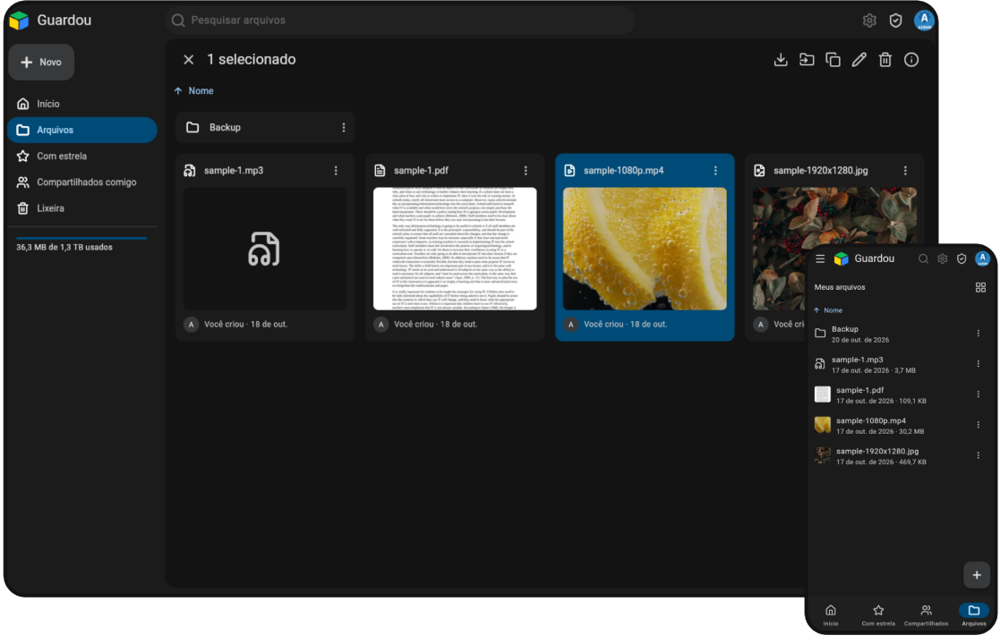

<h1 align="center">Guardou!</h1>
 

  

 

## About

Guardou is a self-hosted file storage solution. Designed to be a simple alternative for users who want to store and organize some files through a simple web ui.

**Core Features:**
- Multiple users
- SSO Support
- URL sharing

## Features

| Feature                    | Status  |
|----------------------------|---------|
| Multiple Users             | Yes     | 
| Sharing                    | Yes*    |
| OIDC-Based SSO             | Yes     |
| Resumable Uploads          | Planned |
| Quotas                     | Planned |
| Real Time Updates          | Planned |
| Document Editing           | TBD     |
| Native Android & iOS Apps  | Planned |

\* ead-only sharing is available through URLs and direct shares. Edit access is planned to be added soon, in the form of collaborative spaces.

## Getting Started

The installation guide can be found [here](https://guardou.app/docs/overview/quick-start).

## Tech Stack

| Tool    | Version        |
|---------|----------------|
| .NET    | 10             |
| C#      | 14             |
| Flutter | 3.47.8         |

## Disclaimer

Guardou is in early-stage development. Breaking changes can happen. For this reason, it is only recommended for personal/home use.

If you decide to use it, follow the [3-2-1](https://www.backblaze.com/blog/the-3-2-1-backup-strategy/) backup strategy.

## AI Disclaimer

Guardou uses AI-assisted code, with a careful approach to ensure code quality. We understand this may be a dealbreaker for some. Further details on what type of AI usage is allowed are explained in [CONTRIBUTING.md](CONTRIBUTING.md).
