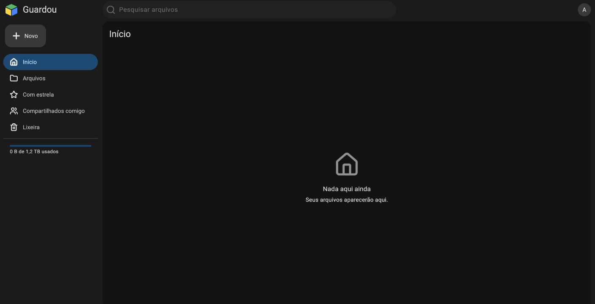

# Quick Start

This is a quick install guide for Guardou.
Once you've tried it, you might want to explore a more complex setup.

---

## Requirements

- A system with at least 1 GB of RAM.
- [Docker](https://docs.docker.com/engine/install/) installed.

---

## Setup

### Step 1 - Download the necessary files

Create a new folder to hold the necessary files.

Download the most recent [`docker-compose.yaml`](https://github.com/GuardouApp/Guardou/releases/latest/download/docker-compose.yaml) into it.

Download the most recent [`example.env`](https://github.com/GuardouApp/Guardou/releases/latest/download/example.env) into it.

### Step 2 - Populate custom values

Rename the `example.env` file to `.env`.

Set `DATA_PATH` to the location where your documents will be stored.
It should be a new directory on the server with enough free space.

The user and group the container runs as (`PUID` and `PGID`, default: 1000) must have write access to that directory.

:::warning[Take care]

Guardou is not a UI for the file system. It stores files in a specific folder structure that is not meant to be changed manually.

:::

### Step 3 - Start the container

From the folder you created in Step 1, run the following command to start Guardou:

```bash
docker compose up -d
```

### Step 4 - Create the first user

Navigate to http://localhost:2286 and create the admin account.

You should be redirected to the initial page.


